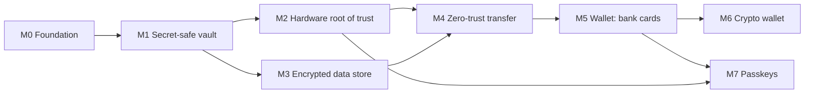

# 00 — Milestone overview

**Product:** Zafonyx Local
**Current release line:** 2.3.0
**Platforms:** Windows, macOS, iOS, Android (Linux planned; web not supported)
**Model:** Local-first. The vault and its key stay on the device; no server holds either.

Related: [cryptography](../cryptography.md) for the key hierarchy in full,
[threat model](../threat-model.md) for adversary coverage and residual risk,
[data protection](../data-protection.md) for what can leave the device, and
[assurance](../assurance.md) for what is verified.

---

## 1. Architecture at a glance

```
┌───────────────────────────────────────────────────────────────┐
│ User interface                                                │
│  lock screen · accounts · authenticator · securities          │
│  wallet (planned) · transfer · settings                       │
└───────────────┬───────────────────────────────────────────────┘
                │
┌───────────────▼───────────────────────────────────────────────┐
│ Application services                                          │
│  account records · authenticator records                     │
│  card / crypto records (planned) · encrypted store            │
│  backup container · transfer session · clipboard              │
│  security scoring · purchase entitlement                      │
└───────────────┬───────────────────────────────────────────────┘
                │
┌───────────────▼───────────────────────────────────────────────┐
│ Vault key layer — one interface, per-platform backends        │
│  device security chip · OS keystore · application PIN wrap    │
│                                                               │
│  wrap record · presence-gated release · protected session      │
└───────────────┬───────────────────────────────────────────────┘
                │
        vault key (32 bytes)
        ├── authenticated encryption per secret
        └── key derivation per purpose (e.g. database key)
```

**Key hierarchy**

```
user presence (biometric / device gesture)   or   app PIN
        │
        ▼
hardware or OS wrapping key  →  wrapped vault key (wrap record)
        │
        ▼
32-byte vault key
        ├── authenticated encryption: passwords, authenticator secrets, backups
        └── purpose-derived key: encrypted database
```

The vault key is always 32 bytes and its ciphertext format does not change. Each milestone changes only **where the key rests** and **what it protects**.

---

## 2. Milestone dependencies



- M2 and M3 are independent of each other but both feed M4.
- M4 needs the wrapped-key layer for the database key and the encrypted database as a transactional merge target.
- M5 / M6 / M7 are additive: they must not reopen the storage or crypto decisions made in M1–M4.

---

## 3. Cross-cutting invariants

| # | Invariant | Consequence |
|---|-----------|-------------|
| 1 | The vault key never leaves the device and is never stored unwrapped | Only a wrap record rests on disk; the live key is a protected native session, not a long-lived app-level buffer |
| 2 | Secrets are bytes, not strings | Wipeable buffers with one owner; ciphertext may be text because it needs no wiping |
| 3 | Every secret buffer has exactly one owner | Helpers borrow, owners clear |
| 4 | No secret in logs, crash reports, or diagnostic output | Tokens, PINs, passwords, authenticator seeds, and raw pairing codes are excluded |
| 5 | Confidentiality covers content and metadata | Category names, titles, notes, and counts must not leak in a backup or transfer body |
| 6 | No silent downgrade | Old peers are refused rather than served a weaker protocol |
| 7 | One schema per record type | Accounts, authenticator items, cards, and crypto backups each have their own store and backup key |
| 8 | Local-first | No cloud relay, no server-side key, no account required for vault function |
| 9 | The device lock PIN is a device credential | Never transmitted, never used as a transfer key, never stored in plaintext where hardware can seal it |
| 10 | User presence is required to release the key | A background process cannot unwrap the vault by reading a file |

---

## 4. Threat model

The protection column describes the current release. Where a threat was only partly covered in earlier releases, the milestone that closed it is named; the nature of the earlier gap is deliberately not described.

| Threat | Protection |
|--------|------------|
| Stolen disk or copied app-data folder | Hardware wrap; a copied folder cannot be unwrapped on any hardware-backed platform (M2) |
| Malware running as the logged-in user | Unwrap needs a user gesture or the hardware PIN, not a file read (M2) |
| Crash dump or process snapshot | Protected native session and wipeable buffers instead of a long-lived plaintext key (M1, M2) |
| LAN observer during pairing or transfer | Post-quantum handshake; every body sealed; the token is never transmitted (M4) |
| Stolen backup file | Whole document sealed under a passphrase-derived key; no metadata in the clear (M4) |
| Old peer forcing a weaker exchange | Explicit protocol version; old peers refused; no fallback (M4) |
| Offline brute force of the app PIN | Hardware counter or memory-hard wrap (M2); residual risk only on devices with no security hardware |
| An optional record type leaking into account data | One store per record type; the account store never holds a card, seed, or passkey (M5–M7) |
| Silent use of a passkey | A platform gesture is required for every assertion (M7) |

**Accepted residual risk:** a process that is already the same user and can observe the app during a cryptographic operation. Hardware wrapping hardens offline copies and resting memory; it does not defeat code injection. See [open-questions.md](../open-questions.md) §4 for how far each claim reaches.

---

## 5. Technology stack

| Layer | Choice | Notes |
|-------|--------|-------|
| UI | Flutter / Dart | 13 locales |
| Vault cipher | AES-256-GCM | Per-secret authenticated encryption |
| Database | SQLCipher | Encrypted relational store |
| Passphrase KDF | Argon2id | Memory-hard; parameters travel with the container |
| Post-quantum KEM | ML-KEM-768 | Ephemeral per transfer session |
| Key custody | OS keystore or device security chip | Released only after user presence; see M2 |
| One-time codes | RFC 6238 | Multiple algorithms, digit counts, and periods |
| Code scanning | QR | Pairing and authenticator import |
| Store unlock | Platform in-app purchase | One-time unlock |
| Crash reporting | Optional third-party service, opt-out | No vault contents, secrets, or clipboard |

---

## 6. Release timeline

| Release | Milestone | Status | Headline |
|---------|-----------|--------|----------|
| 2.0 – 2.1 | M0 | Shipped | App shell, local vault, store unlock |
| 2.2.0 | M1 | Shipped | Built-in authenticator |
| 2.2.2 | M1 | Shipped | Byte-only secrets, clipboard clear, stability fixes |
| 2.2.6 | M1 | Shipped | Product rename |
| 2.2.7 | M2 | Shipped | Presence-gated key custody from a device security chip |
| 2.2.8 | M3 | Shipped | Encrypted relational database |
| 2.3.0 | M4 | Shipped | Passphrase backup container, one-way sharing, post-quantum pairing |
| 2.4.0 | M5 | Planned | Account / Wallet / Securities, bank cards |
| 2.5.0 | M6 | Planned | Cryptocurrency backup records |
| 2.6.0 | M7 | Planned | Passkeys |

---

## 7. What each milestone unlocks

| Milestone | User-visible outcome | Architectural outcome |
|-----------|----------------------|-----------------------|
| M0 | A local password manager on four platforms | Category/entry model, per-secret encryption, lock screen |
| M1 | Authenticator codes inside the app; safer copy and input | Separate authenticator store; byte-level secret handling |
| M2 | Unlock with a device gesture; key sealed in a security chip | Key-custody layer; wrap record; protected session |
| M3 | Faster, transactional vault; explicit reset instead of corruption | Relational store; verified migration from the old format |
| M4 | Passphrase-protected backup; one-way sharing; safe LAN transfer | One sealed container; authenticated transfer session |
| M5 | Bank cards in a separate Wallet section | Per-record-type stores; additive backup keys |
| M6 | Crypto backup records in Wallet | Storage-only crypto schema |
| M7 | Passkeys without a browser extension | Platform authenticator integration |

---

## 8. Non-goals across all milestones

- Cloud sync, a server-side vault, or server-assisted account recovery.
- Changing the vault cipher format or rotating the vault key as part of a feature.
- Storing cards, crypto backups, or passkeys inside the account store.
- Defeating a live, fully compromised process (injection, hooking during a crypto operation).
- Bluetooth transfer, cloud relay, or multi-receiver sharing.
- Recovering a forgotten backup passphrase.
- Publishing implementation identifiers, schemas, or wire layouts in these documents.

---

## 9. How to add or change a milestone doc

1. **Snapshot** — release, status, dependencies, what it unlocks.
2. **Goal** — the property the milestone establishes.
3. **Problem** — what the previous state could not guarantee, described without exploitable detail.
4. **Design** — the model and the guarantees, at capability level rather than implementation level.
5. **Decisions and rejected alternatives** — why this design, and what was deliberately not built.
6. **Components** — responsibilities, not code structure.
7. **Security properties** — statements checkable from outside the implementation, including negative cases.
8. **Risks** — residual exposure and open items.
9. **Provenance** — one line saying the summary derives from shipped behaviour, without citing internal artefacts.

Before adding detail, apply the [disclosure model](../README.md). The test for any sentence:

- Does it describe *what is guaranteed*, or *how it is built*? Only the first belongs here.
- Would it let a reader target a specific platform build? If so, generalize to the capability tier.
- Does it identify an internal project, document, or person? Remove it.
- Is it a parameter value, schema, key name, or wire field? Remove it.
